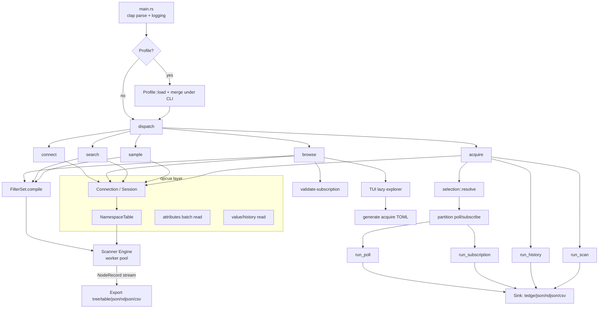

# Architecture — opcua-scan

> Companion to [spec.md](spec.md). Describes the runtime architecture, module boundaries, control/
> data flow, concurrency model, and dependencies. Evidence labels: **[Confirmed]**, **[Likely]**,
> **[Assumption]** (see [assumptions.md](assumptions.md)).

---

## 1. High-level shape

`opcua-scan` is a **single-binary, async CLI**. There are no servers, daemons, databases, or queues
of its own; the only external service is the **OPC UA server** it connects to. State is held in
memory per invocation, with two small on-disk artifacts: an optional **namespace cache** and
user-managed **profile**/**acquire config** files. **[Confirmed]**



---

## 2. Control flow (entry point)

`src/main.rs` **[Confirmed]**:
1. `Cli::parse()` (clap derive).
2. `logging::init(verbose, quiet)` — configure `tracing` to **stderr**.
3. `apply_profile(&mut cli)` — if `--profile` set, load YAML and merge defaults **under** parsed
   args (CLI wins). Acquire is config-driven, so profiles don't apply to it.
4. `signal::install()` — returns an `Arc<AtomicBool>` cancel flag; first Ctrl+C sets it, second
   exits `130`.
5. Dispatch to `cli::<cmd>::run(...)`, passing the cancel flag to long-running commands.
6. On `Err`, print `error: {err}` to stderr and `exit(err.exit_code())`.
7. On clean return after a Ctrl+C, `exit(4)`.

Exit codes (`src/error.rs`): `0` ok, `1` general, `2` invalid usage/args/pattern/config, `3`
connection failure, `4` cancelled. **[Confirmed]**

---

## 3. Module boundaries

| Module | Responsibility | Key public types |
| --- | --- | --- |
| `cli` | Argument schema (clap) + per-command orchestration. | `Cli`, `Command`, `ConnectionArgs`, `TraversalArgs`, `FilterArgs`, `OutputArgs`, `*Args` |
| `opcua` | Wrap `async-opcua`: connect, browse, read attributes/values/history, namespaces. | `Connection`, `ServerInfo`, `NamespaceTable`, `NodeAttributes`, `ValueReading`, `HistoryQuery` |
| `scanner` | Concurrent traversal orchestration + stats. | `Engine`, `ScanConfig`, `ScanStats` |
| `filters` | Compile CLI filter args into a composite filter; decide prune/descend/emit. | `FilterSet`, `PathDecision`, `PatternSet`, `Predicate`, `DataTypeMatcher` |
| `export` | Render/serialize `NodeRecord`s. | `NodeRecord`, `render_display`, `write_export` |
| `acquire` | Config-driven acquisition: schema, selection, sinks, orchestration, config-gen. | `AcquireConfig`, `SelectedNode`, `Sink`, `Sample`, `SampleMeta`, `generate_toml` |
| `subscription` | Monitored items: validate, sample, live subscription→sink. | `SubscriptionParams`, `validate_records`, `run_sample`, `run_subscription` |
| `tui` | Interactive ratatui explorer; mark→export/acquire. | `TuiOptions` |
| `config` | `Profile` (YAML) load + merge into CLI args. | `Profile` |
| `cache` | Best-effort namespace-table cache. | `Cache` |
| `error` | Unified `ScanError` + `exit_code()`. | `ScanError`, `Result<T>` |
| `logging`, `signal` | tracing init; Ctrl+C handling. | `init`, `install` |

Dependency direction: `cli` → (`opcua`, `scanner`, `filters`, `export`, `acquire`, `subscription`,
`tui`, `config`, `cache`); everything → `error`. `scanner` depends on `opcua` + `filters` + `export`.
`acquire` depends on `opcua` + `scanner` + `filters` + `subscription` + `export`. **[Confirmed]**

---

## 4. Concurrency model (scanner)

The traversal engine (`src/scanner/engine.rs`) implements a **bounded worker pool** over a shared
work queue. **[Confirmed]**

- **Shared state (`Shared`)**: `queue: Mutex<VecDeque<Pending>>`, `active: AtomicUsize`,
  `notify: Notify`, `cancel: Arc<AtomicBool>`, `visited: Mutex<HashSet<NodeId>>`, `dfs: bool`.
- **Strategy:** BFS pops the front (`pop_front`), DFS pops the back (`pop_back`) of the same queue.
- **Per node (`expand`)**: browse children (following continuation points, honoring `max_children`),
  **batch-read all child attributes in one service call**, apply `path_decision` then
  `attributes_match`, emit `NodeRecord` via an `mpsc::Sender`, optionally read current value, and
  enqueue children whose depth still allows descent.
- **Cycle protection:** a node id is processed at most once (`visited` set).
- **Retry/backoff:** transient OPC UA statuses (`BadTimeout`, `BadTooManyOperations`,
  `BadServerTooBusy`, `BadNoContinuationPoints`, `BadServerNotConnected`) are retried with backoff
  `min(100ms << attempt, 2000ms)` up to `--retry`.
- **Cancellation:** workers poll the shared `cancel` flag; a closed sink channel also cancels.
- **Backpressure/memory:** records are **streamed** through a bounded `mpsc` channel to the consumer
  (export/validate), keeping memory low on huge address spaces. **[Likely — channel boundedness]**

`ScanStats` tracks `visited`, `matched`, `pruned`, `errors`, `subscribable`, `truncated`, elapsed. **[Confirmed]**

### Acquire concurrency
`acquire::run` connects once, resolves the selection, then launches a `JoinSet` of tasks: scan
task(s), history task(s), a single poll loop (ticker → batch `read_readings` → emit), and a single
live subscription, all feeding one shared `Sink`. A duration timer can set the cancel flag to bound
continuous tasks. **[Confirmed]**

---

## 5. Data flow

### Discovery (browse/search/sample)
```
endpoint+args → Connection::connect → Session
             → NamespaceTable::read (or cache hit)
             → FilterSet::compile(filters, namespaces)
             → Engine::run(sink=mpsc) ──stream──> NodeRecord
                                                   ├─ browse: render/export (+ optional validate)
                                                   ├─ search: fuzzy score + top-N
                                                   └─ sample: collect ids → run_sample (live)
```

### Acquisition (acquire)
```
AcquireConfig (TOML) → Connection::connect → NamespaceTable
  → selection::resolve (explicit nodes remapped by ns URI + filtered discovery + metadata enrich)
  → partition_nodes(default_mode, poll_only) → (poll_nodes, subscribe_nodes)
  → JoinSet { scan*, history*, poll-loop, subscription } → Sink (tedge|json|ndjson|csv)
  → persist reconstructed browse paths back into the config file
```

### TUI
```
browse --tui → TuiOptions::run → lazy browse on expand → mark subtrees
  → 'e' export loaded nodes (json/ndjson/csv)
  → 'a' generate/update acquire TOML (generate_toml / update_selection_in_toml)
```

---

## 6. Key invariants & cross-cutting rules **[Confirmed]**

1. **stdout is data, stderr is logs.** Machine output never mixes with logging.
2. **Paths use namespace URIs**, not session-local indexes (indexes can change per session).
3. **Filters apply during traversal**: excluded branches are pruned (not browsed); attribute
   predicates are the final emission gate.
4. **Secrets are never logged**; passwords resolve from `env:VAR` or secure prompt.
5. **Secure by default**: server certs auto-trusted only via `--trust-server`.
6. **Subscribable = readable Variable** (heuristic); confirm with `--validate-subscription`.
7. **CLI flags override profile defaults**; profile only fills unset values.
8. **Terminal is always restored** on TUI exit, even on panic.

---

## 7. Dependencies

Runtime (from `Cargo.toml` `[dependencies]`) **[Confirmed]**:

| Crate | Version | Role |
| --- | --- | --- |
| `async-opcua` | 0.18 (client) | OPC UA client/session/services |
| `tokio` / `tokio-util` / `futures` | 1 / 0.7 / 0.3 | async runtime + utilities |
| `clap` | 4.5 (derive, env, wrap_help) | CLI parsing |
| `serde` / `serde_json` / `serde_yaml` / `toml` / `toml_edit` / `csv` | — | (de)serialization for records, profiles, configs, exports |
| `globset` / `regex` / `fuzzy-matcher` | — | path globbing, regex, fuzzy search |
| `tracing` / `tracing-subscriber` / `indicatif` | — | logging + progress |
| `thiserror` / `anyhow` / `humantime` / `dirs` / `rpassword` | — | errors, durations, dirs, secure prompt |
| `ratatui` / `crossterm` | 0.28 / 0.28 | TUI (only when `--tui`) |

Dev-only **[Confirmed]**: `async-opcua` with `server` feature (in-process test server), `tempfile`.

Release profile **[Confirmed]**: `lto = "thin"`, `codegen-units = 1`, `strip = true`.

---

## 8. Failure handling

All fallible paths return `Result<T> = Result<T, ScanError>`. `ScanError` variants map service
failures (`Service { service, status }`), connection issues (`Connect`, `ConnectTimeout`,
`InvalidEndpoint`, `ClientBuild`), config/pattern/argument errors, export/terminal/IO, and a catch-all
`Other(anyhow)`. `exit_code()` collapses these into the five stable codes. **[Confirmed]**

Transient OPC UA errors are absorbed by the engine's retry/backoff and counted in `stats.errors`
rather than aborting the whole scan. **[Confirmed]**
